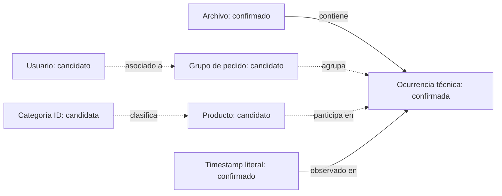

# Viabilidad analítica y modelo conceptual preliminar

Actualización: 2026-10-20. PLATHEL Proyecto 01; Aurelia Jewelry, cliente ficticio. Basado en [DATA_DICTIONARY.md](DATA_DICTIONARY.md) y evidencias E01–E10/S01–S07 de [SEMANTIC_VALIDATION.md](SEMANTIC_VALIDATION.md). No se calcularon KPIs comerciales ni se crearon SQL, tablas o modelos de Power BI.

## Criterios de estado

Los estados operativos son HABILITADO, CONDICIONAL y BLOQUEADO, con alcance y requisitos en la matriz. El estado de una capacidad no confirma los significados de sus campos, que conservan CONFIRMADO / PROVISIONAL / NO RESUELTO.

P1–P13 se refieren exclusivamente a posiciones largas. C1–C11 se refieren a posiciones cortas; no son un esquema alineado. La correspondencia C6→P8 y C7→P9 sigue siendo candidata; las cortas permanecen pendientes. Todos los campos originales siguen siendo texto. El ID técnico identifica ocurrencias, no una unidad comercial.

## Matriz de viabilidad vigente — 2026-10-20

HABILITADO significa únicamente el alcance técnico descrito. CONDICIONAL permite formular el diseño, pero no ejecutar ni publicar un KPI sin cerrar sus requisitos. BLOQUEADO impide el resultado empresarial indicado con la evidencia actual. Los escenarios no son autorizaciones de implementación.

| Capacidad / objetivo empresarial | Datos necesarios | Evidencia disponible | Evidencia faltante | Estado | Riesgo | Próxima validación |
|---|---|---|---|---|---|---|
| Calidad: evaluar aptitud de la fuente | Texto, línea, hash, reglas | E01–E10, v1 conserva todas las ocurrencias | Reglas comerciales para calidad semántica | HABILITADO | Confundir formato válido con negocio válido | Contrato de datos |
| Productos: describir surtido observado | ID, SKU/variante, atributos | P3 y atributos; 9.613 IDs candidatos globales | Maestro y ámbito de ID, cortas sin atributos | CONDICIONAL | Presentar IDs como catálogo completo | Diccionario y reconciliación con maestro |
| Pedidos: contar compras elegibles | ID pedido, líneas, estado | P2/C2; 74.760 grupos candidatos; S06 | Posición oficial, estados, clave de línea | CONDICIONAL | Grupo técnico ≠ pedido pagado | Contrato y muestra autorizada conciliada |
| Clientes: dimensionar compradores | Identidad persistente, elegibilidad | P9/C7 candidatos coherentes con grupos | Cuenta/persona/dispositivo, persistencia | CONDICIONAL | IDs ≠ personas ni padrón total | Política de identidad |
| Ventas e ingresos: medir actividad monetaria | Importe, moneda, cantidad, estados, ajustes | Decimal P8/C6 y constante P4/C4 | Semántica monetaria y multiplicidad | BLOQUEADO | Precio catálogo ≠ cobro; ceros ambiguos | Contrato monetario y conciliación |
| Ticket promedio: valor por pedido | Ingreso validado y pedidos elegibles | Grupos y decimal candidatos | Requisitos de ventas/pedidos | BLOQUEADO | Numerador y denominador sin contrato | Validar ambos antes de dividir |
| Temporal: analizar evolución | Fecha comercial, cobertura, calendario | Timestamp válido; 14 fechas sin registros | Etapa comercial, zona de negocio, completitud | CONDICIONAL | Ausencia de registros ≠ ventas cero | Contrastar captura y límites de período |
| Recompra: repetición de pedidos por comprador | Usuario estable, pedido, ventana | E03/E04 | Identidad, elegibilidad y cobertura | CONDICIONAL | Contar líneas como compras | Definir pedido distinto y ventana común |
| Cohortes: seguimiento de compra observada | Primera compra observada y seguimiento | Fechas e IDs candidatos | Censura, identidad, períodos completos | CONDICIONAL | Primera observación ≠ adquisición | Validar madurez; adquisición real BLOQUEADA sin fuente |
| RFM: priorizar clientes por comportamiento | R/F definidos y M validado | Candidatos temporales e IDs | Moneda/importe y contratos de identidad/pedido | BLOQUEADO | Puntajes precisos sobre variables ambiguas | Resolver P0/P1 y corte explícito |
| Rentabilidad: margen | Ingreso neto, costos y ajustes | No hay costos identificados | Fuentes financieras y reglas | BLOQUEADO | Precio ≠ beneficio | Incorporar fuentes autorizadas |
| Inventario: rotación y quiebres | Stocks, movimientos y SKU | Sin serie de existencias | Disponibilidad, entradas/salidas | BLOQUEADO | Sin ventas ≠ sin demanda o stock | Obtener inventario conciliable |
| Predicción de demanda: planificar abastecimiento | Demanda elegible, exposición, stock, historia | Solo ocurrencias con semántica pendiente | Objetivo, cobertura, stock, horizonte y validación temporal | BLOQUEADO | Ventas observadas ≠ demanda; fuga temporal | Diseñar contrato del objetivo y backtesting, sin entrenar |
| Segmentación: grupos interpretables | Identidad, variables válidas, propósito | Atributos de producto y usuarios candidatos | Base semántica, estabilidad y evaluación | BLOQUEADO | f/m de producto tratado como demografía | Resolver identidad/variables; no entrenar |

### Alcance técnico habilitado dentro de calidad de datos

La capacidad de calidad de datos habilita describir posiciones, dominios, vacíos y timestamps del archivo, separando anchuras. Incluye el perfil posicional de atributos y el perfil temporal técnico, sin afirmar surtido comercial completo, ventas ni evolución empresarial. Estos son controles de la primera capacidad, no capacidades comerciales adicionales.

Las filas Productos y Temporal de la matriz tienen un único estado **CONDICIONAL** para su objetivo empresarial. Ninguna hereda habilitación comercial por disponer de un perfil técnico.

Conversión, abandono, CAC y ROAS siguen BLOQUEADOS: no se identificaron eventos de navegación, sesiones, campañas, gasto o adquisición real. No se crean variables sustitutas inventadas.

## Reglas de diseño antes de cualquier cálculo futuro

1. Mantener la población completa y contar ocurrencias técnicas con su multiplicidad. No borrar los 2.589 excedentes ni derivar cantidades por suposición.
2. Separar perfil largo y corto. Un subconjunto de largas no representa toda la tienda; la ausencia corta se concentra en 2021 y en IDs de producto distintos.
3. Definir unidad comercial, estado de transacción y denominador antes de fórmulas. Campo constante 1 no demuestra cantidad; un decimal estable por producto no demuestra importe cobrado.
4. Distinguir población observada, compra elegible, cliente y persona. No usar f/m como demografía del usuario ni conteo de IDs como personas sin validar identidad.
5. Fijar corte, zona horaria y madurez de cohortes. Las fechas sin registros no se imputan con cero; primera compra observada no equivale a adquisición real.
6. Precisar los permisos no resueltos antes de decidir usos externos adicionales. El proyecto continúa prohibiendo publicar registros aunque se obtenga una licencia permisiva.

## Modelo conceptual preliminar, sin implementación

Se propone un vocabulario conceptual para revisar futuras relaciones de SQL/Power BI. No es esquema físico, DDL, modelo dimensional ni autorización de desarrollo.

| Entidad conceptual | Evidencia / grado | Identificación candidata y relaciones | Límites |
|---|---|---|---|
| Archivo fuente | CONFIRMADO, E01 | Hash identifica contenido; contiene ocurrencias y línea vacía registrada | No identifica por sí solo la edición pública o licencia |
| Ocurrencia de registro | CONFIRMADO, E09 | row_id técnico, una por línea no vacía; pertenece a un archivo | No es inequívocamente evento, unidad, pedido o línea comercial |
| Grupo de pedido candidato | PROVISIONAL, E04 | P2/C2; cada grupo tiene una combinación fecha/usuario candidato y una o más ocurrencias | ID no único por fila ni confirmado como pedido pagado |
| Producto candidato | PROVISIONAL, E04/E05 | P3/C3; un producto participa en muchas ocurrencias; atributos largos consistentes | Sin maestro completo, talla/variante ni cambios históricos demostrados; cortas disjuntas |
| Usuario candidato | PROVISIONAL, E04 | P9/C7 candidato; un usuario se vincula a varios grupos de pedido | No equivale a persona ni garantiza permanencia de IDs |
| Categoría ID candidata | PROVISIONAL, E05 | P5; agrupa productos largos. Etiqueta P6 como descriptor, no clave única | Seis códigos textuales se asocian a varios IDs; códigos ausentes |
| Atributos de producto candidatos | PROVISIONALES, E05/E08 | P10–P13 y eventualmente código P7 asociado a producto | No son dimensiones aprobadas ni demografía del cliente; P7 desconocido |
| Calendario derivado | HIPOTÉTICO como entidad futura | Podría relacionar timestamp con períodos, una vez definida hora de negocio | No se creó tabla ni dimensión; períodos incompletos/censura |
| Línea comercial / variante / unidad | HIPOTÉTICAS | Podrían explicar varias ocurrencias repetidas dentro de un grupo | No existe clave fuente identificada que permita distinguirlas |

Relaciones conceptuales bajo las hipótesis, sin imponer restricciones definitivas:

Archivo→ocurrencia es una relación técnica confirmada uno a muchos. Las relaciones pedido→ocurrencia, producto→ocurrencia y usuario→pedido son uno a muchos **solo bajo las interpretaciones candidatas**. No definir todavía foreign keys, claves únicas de negocio, reglas de agregación monetaria o relaciones bidireccionales de Power BI. El código textual de categoría no es una clave segura; `(pedido, producto)` no distingue ocurrencias repetidas.

No se propone una entidad de marca confirmada: P7 no está identificado. Tampoco se crean entidades de pago, devolución, campaña, inventario o costo a partir de campos ambiguos. El valor P8 permanecería en la evidencia de la ocurrencia hasta confirmar si es precio de catálogo, precio unitario o importe de línea; no se decide todavía ubicarlo como medida de ventas o atributo fijo del producto.

## Recomendación de paso de fase

**GO CON CONDICIONES para revisar y refinar este modelo conceptual preliminar.** No equivale a GO para implementarlo: el alcance actual termina en documentos. Para modelo físico/dimensional definitivo o métricas comerciales: **NO GO mientras estén abiertos los bloqueos de unidad de registro, cantidad, precio/moneda, identidad, repetidos y cobertura que afecten al indicador**.

Próximo paso verificable: completar el mapeo de edición y recuperar su diccionario, contestar la lista de cuestiones de SEMANTIC_VALIDATION.md y registrar las resoluciones con fuente y alcance. Cualquier relajación debe ser una decisión explícita, no un cambio silencioso de PROVISIONAL a CONFIRMADO. Las condiciones publicadas ya están identificadas; su alcance no resuelto debe precisarse antes de usos externos adicionales.

## Lectura del modelo conceptual y valor para el cliente

Archivo fuente→ocurrencia técnica es relación confirmada por hash y trazabilidad. Los agrupamientos observados P2→fecha/usuario y P3→atributos son dependencias del archivo, no contratos comerciales. Pedido candidato→ocurrencias, producto candidato→ocurrencias y usuario candidato→pedidos requieren confirmar posiciones, estados y ámbitos de ID. Los atributos candidatos pertenecen al producto bajo hipótesis; no constituyen demografía del comprador. La declaración S06 respalda el contexto de productos comprados, pero no impone claves únicas ni resuelve multiplicidad.

No se crean tablas SQL, dimensiones definitivas ni relaciones Power BI. `(pedido, producto)` no es clave única. El decimal permanece como evidencia posicional; no se decide convertirlo en medida de ventas o atributo maestro.

La auditoría detecta contratos incompletos, dobles conteos potenciales, cobertura desigual y riesgo de inferir ingresos o identidad sin soporte. Permite decidir si invertir en una integración, solicitar otra fuente o limitar el entregable a calidad. PLATHEL puede ofrecer diagnóstico de aptitud analítica, contratos de datos, trazabilidad y pruebas de aceptación, reconciliación y evaluación de viabilidad BI/DS. Un cliente recibiría inventario y diccionario con confianza, registro de evidencias, matriz de riesgos, modelo conceptual y plan priorizado de remediación. No se prometen ahorros ni resultados comerciales no medidos.

Procedimiento por disponibilidad de información y sensibilidad experimental: [SEMANTIC_SCENARIOS.md](SEMANTIC_SCENARIOS.md).
