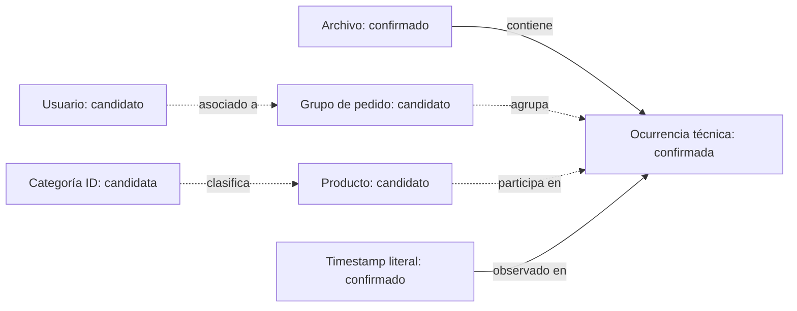

# Viabilidad analítica y modelo conceptual preliminar

Fecha: 2026-10-19. PLATHEL Proyecto 01; Aurelia Jewelry, cliente ficticio. Basado en [DATA_DICTIONARY.md](DATA_DICTIONARY.md) y evidencias E01–E09/S01–S05 de [SEMANTIC_VALIDATION.md](SEMANTIC_VALIDATION.md). No se calcularon KPIs comerciales ni se crearon SQL, tablas o modelos de Power BI.

## Criterios de estado

- **VIABLE:** descripción técnica directamente respaldada por el archivo observado; el alcance exacto se especifica. No implica representar ventas completas de una empresa.
- **CONDICIONAL:** existen campos candidatos pero faltan definiciones o cobertura. Puede diseñarse una hipótesis; no debe publicarse el indicador como negocio validado.
- **NO SOPORTADO:** faltan variables esenciales en lo disponible. No se pueden reemplazar por supuestos para declarar el indicador viable.

P1–P13 se refieren exclusivamente a posiciones largas. C1–C11 se refieren a posiciones cortas; no son un esquema alineado. La correspondencia C6→P8 y C7→P9 sigue siendo candidata; las cortas permanecen pendientes. Todos los campos originales siguen siendo texto. El ID técnico identifica ocurrencias, no una unidad comercial.

## Matriz de indicadores potenciales

| Indicador / alcance | Datos necesarios | Campos disponibles | Supuestos o verificaciones pendientes | Riesgo de interpretación | Estado |
|---|---|---|---|---|---|
| Conteos técnicos de registros, anchuras, vacíos y repetidos | Texto, posiciones, línea y hash | Metadatos v1 y todos los campos posicionales | Mantener denominadores por anchura; no llamarlos compras | Confundir filas con pedidos/unidades | VIABLE, técnico |
| Unidades vendidas | Cantidad y estado de transacción; granularidad real | P4/C4 siempre 1; P2/P3 candidatos | Confirmar cantidad, unidades/variantes repetidas, estados y cobertura | Sumar 1 por fila puede contar copias o subcontar unidades; no se sabe si es cantidad | CONDICIONAL |
| Ventas brutas / ingresos transaccionales | Importe efectivamente vendido, moneda, cantidad si aplica y fecha de reconocimiento | P8 decimal, P1, P2/P3; C6 candidato | Precio unitario vs importe de línea, catálogo vs cobrado, moneda, impuestos, descuentos, granularidad/cortas | P8 es constante por producto; no demuestra cobro. Repetidos o corte de cobertura distorsionan importes | CONDICIONAL |
| Ventas netas / ingresos contables | Ventas validadas, devoluciones, cancelaciones, descuentos, impuestos y política contable | No hay estados ni ajustes identificados | Obtener fuentes de estados/ajustes y reglas contables | Presentar importe candidato como facturación neta | NO SOPORTADO actualmente |
| Pedidos | ID comercial, estado, cobertura y relación de líneas | P2/C2 con fecha/usuario coherentes | Confirmar que es pedido y qué estados registra; alcance de IDs y de la edición | Contar grupos de exportación como pedidos pagados | CONDICIONAL |
| Ticket promedio | Ingreso validado por pedido y número de pedidos elegibles | Candidatos P2, P8, P4 y fecha | Todos los anteriores, incluyendo política de multiplicidad e importe | Dividir suma decimal sin validar por grupos produce un número sin significado comercial confirmado | CONDICIONAL |
| Distribución observada de códigos/atributos de producto | IDs y etiquetas por anchura | P3/P5/P6/P10–P13; C3 separado | Limitarse a lo observado, declarar vacíos y excluir cualquier afirmación de catálogo total | Confundir frecuencia de filas con volumen vendido o surtido completo | VIABLE solo como perfil descriptivo del archivo |
| Productos únicos comerciales y rendimiento por categoría | SKU/producto real, catálogo, importe/unidades validados | P3 y P5/P6; 9.613 IDs candidatos globales | Confirmar modelo/SKU/variante, jerarquía, alcance relojes/souvenirs y código vacío; cortas sin atributos vinculables | Doble conteo de variantes, categoría textual no única por ID, sesgo de cortas | CONDICIONAL |
| Clientes únicos compradores | Identidad de cliente y transacciones elegibles | P9 y C7 candidato | Confirmar persona/cuenta/dispositivo y persistencia temporal; estado de compra | Un ID no equivale necesariamente a una persona ni al padrón completo | CONDICIONAL |
| Recompra | Cliente estable, pedidos distintos y ventana de observación | P9/P2/P1 y correspondencia corta candidata | Identidad/pedido confirmados, regla de elegibilidad y ventana común | Contar líneas repetidas como compras; historia previa truncada | CONDICIONAL |
| Retención de compradores | Clientes, pedidos y períodos completos comparables | Mismos candidatos temporales | Cohorte de primera compra observada, madurez por período y cobertura/captura | Confundir censura con abandono; no representa retención de visitantes o registrados | CONDICIONAL |
| Cohortes de compra observada | Primera compra observada por ID estable y compras posteriores | P1/P2/P9; cortas pendientes | Elegibilidad de compra, identidad persistente, períodos completos, alineación | Primera observación no es adquisición ni primera compra real | CONDICIONAL |
| Cohortes de adquisición real | Registro/adquisición y canal, historial anterior | No identificados | Requiere otra fuente o historia demostrablemente completa | Atribuir fecha de adquisición a una primera aparición arbitraria | NO SOPORTADO |
| RFM | Recencia desde última compra a corte explícito; frecuencia por pedido distinto; monetario validado | P1/P2/P9 y decimal P8 candidato | Definiciones de compra/cliente, corte temporal, cobertura, cantidad/importe/moneda, política de repetidos | R/F incompletos y M no validado; segmentar sobre valores ambiguos aparenta precisión | CONDICIONAL |
| Rentabilidad / margen | Ingresos netos y costos, logística, impuestos y devoluciones | Costos y ajustes no identificados | Obtener fuentes financieras y unidad monetaria | Precio no es beneficio; material no permite estimar costo confiablemente | NO SOPORTADO |
| Inventario / rotación / quiebres | Stock por fecha, entradas/salidas, disponibilidad y catálogo | Ninguna serie de existencias identificada | Fuente de inventario y correspondencia producto/SKU | Ausencia de registros no equivale a stock cero ni demanda cero | NO SOPORTADO |
| CAC | Gasto de adquisición, clientes nuevos reales y atribución | Gastos/canales/adquisición no identificados | Fuentes de marketing y definición de cliente nuevo | Primera compra observada no es adquisición atribuible | NO SOPORTADO |
| ROAS | Gasto publicitario e ingresos atribuibles comparables | Ningún gasto/campaña/canal identificado; ingresos pendientes | Fuente de campañas, ventana, atribución y moneda común | Atribuir todo importe a publicidad sin evidencia | NO SOPORTADO |

VIABLE no se utiliza para ingresos, pedidos, clientes o RFM mientras las columnas solo tengan significados candidatos. Tampoco habilita construir dashboards: solo distingue qué descripciones del archivo no requieren supuestos comerciales.

## Reglas de diseño antes de cualquier cálculo futuro

1. Mantener la población completa y contar ocurrencias técnicas con su multiplicidad. No borrar los 2.589 excedentes ni derivar cantidades por suposición.
2. Separar perfil largo y corto. Un subconjunto de largas no representa toda la tienda; la ausencia corta se concentra en 2021 y en IDs de producto distintos.
3. Definir unidad comercial, estado de transacción y denominador antes de fórmulas. Campo constante 1 no demuestra cantidad; un decimal estable por producto no demuestra importe cobrado.
4. Distinguir población observada, compra elegible, cliente y persona. No usar f/m como demografía del usuario ni conteo de IDs como personas sin validar identidad.
5. Fijar corte, zona horaria y madurez de cohortes. Las fechas sin registros no se imputan con cero; primera compra observada no equivale a adquisición real.
6. Recuperar licencia y condiciones antes de decidir usos adicionales o publicación. El proyecto continúa prohibiendo publicar registros aunque se obtenga una licencia permisiva.

## Modelo conceptual preliminar, sin implementación

Se propone un vocabulario conceptual para revisar futuras relaciones de SQL/Power BI. No es esquema físico, DDL, modelo dimensional ni autorización de desarrollo.

| Entidad conceptual | Evidencia / grado | Identificación candidata y relaciones | Límites |
|---|---|---|---|
| Archivo fuente | CONFIRMADO, E01 | Hash identifica contenido; contiene ocurrencias y línea vacía registrada | No identifica por sí solo la edición pública o licencia |
| Ocurrencia de registro | CONFIRMADO, E09 | row_id técnico, una por línea no vacía; pertenece a un archivo | No es inequívocamente evento, unidad, pedido o línea comercial |
| Grupo de pedido candidato | INFERIDO, E04 | P2/C2; cada grupo tiene una combinación fecha/usuario candidato y una o más ocurrencias | ID no único por fila ni confirmado como pedido pagado |
| Producto candidato | INFERIDO, E04/E05 | P3/C3; un producto participa en muchas ocurrencias; atributos largos consistentes | Sin maestro completo, talla/variante ni cambios históricos demostrados; cortas disjuntas |
| Usuario candidato | INFERIDO, E04 | P9/C7 candidato; un usuario se vincula a varios grupos de pedido | No equivale a persona ni garantiza permanencia de IDs |
| Categoría ID candidata | INFERIDO, E05 | P5; agrupa productos largos. Etiqueta P6 como descriptor, no clave única | Seis códigos textuales se asocian a varios IDs; códigos ausentes |
| Atributos de producto candidatos | INFERIDOS, E05/E08 | P10–P13 y eventualmente código P7 asociado a producto | No son dimensiones aprobadas ni demografía del cliente; P7 desconocido |
| Calendario derivado | HIPOTÉTICO como entidad futura | Podría relacionar timestamp con períodos, una vez definida hora de negocio | No se creó tabla ni dimensión; períodos incompletos/censura |
| Línea comercial / variante / unidad | HIPOTÉTICAS | Podrían explicar varias ocurrencias repetidas dentro de un grupo | No existe clave fuente identificada que permita distinguirlas |

Relaciones conceptuales bajo las hipótesis, sin imponer restricciones definitivas:

Archivo→ocurrencia es una relación técnica confirmada uno a muchos. Las relaciones pedido→ocurrencia, producto→ocurrencia y usuario→pedido son uno a muchos **solo bajo las interpretaciones candidatas**. No definir todavía foreign keys, claves únicas de negocio, reglas de agregación monetaria o relaciones bidireccionales de Power BI. El código textual de categoría no es una clave segura; `(pedido, producto)` no distingue ocurrencias repetidas.

No se propone una entidad de marca confirmada: P7 no está identificado. Tampoco se crean entidades de pago, devolución, campaña, inventario o costo a partir de campos ambiguos. El valor P8 permanecería en la evidencia de la ocurrencia hasta confirmar si es precio de catálogo, precio unitario o importe de línea; no se decide todavía ubicarlo como medida de ventas o atributo fijo del producto.

## Recomendación de paso de fase

**GO CON CONDICIONES para revisar y refinar este modelo conceptual preliminar.** No equivale a GO para implementarlo: el alcance actual termina en documentos. Para modelo físico/dimensional definitivo o métricas comerciales: **NO GO mientras estén abiertos los bloqueos de unidad de registro, cantidad, precio/moneda, identidad, repetidos y cobertura que afecten al indicador**.

Próximo paso verificable: recuperar metadatos y diccionario de la edición, contestar la lista de cuestiones de SEMANTIC_VALIDATION.md y registrar las resoluciones con fuente y alcance. Cualquier relajación debe ser una decisión explícita, no un cambio silencioso de INFERIDO a CONFIRMADO. La licencia y los permisos de uso se deben resolver antes de usos externos adicionales.
